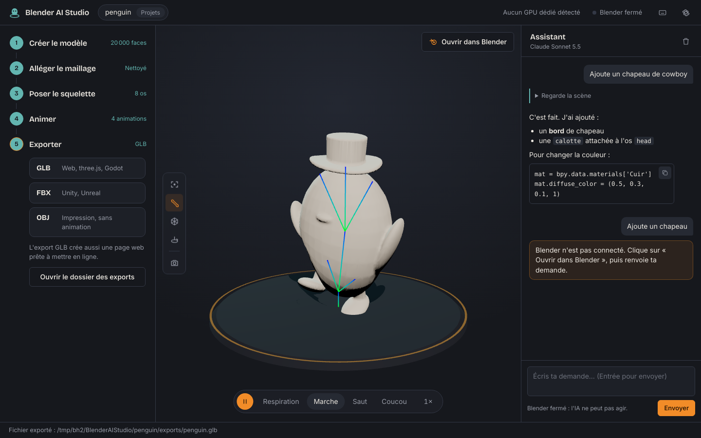
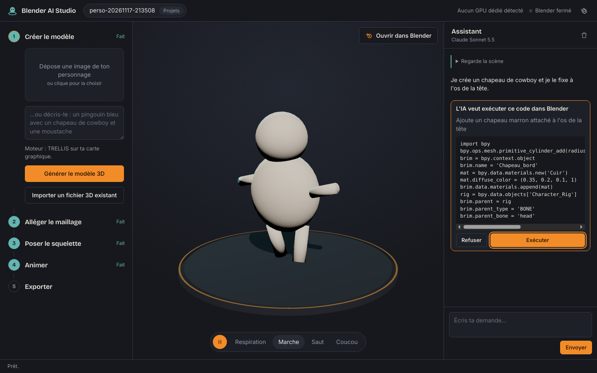
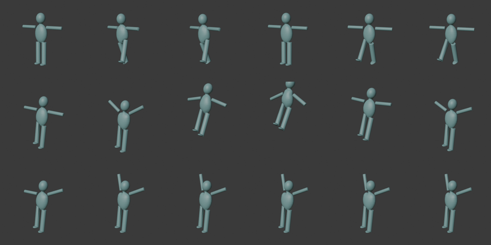
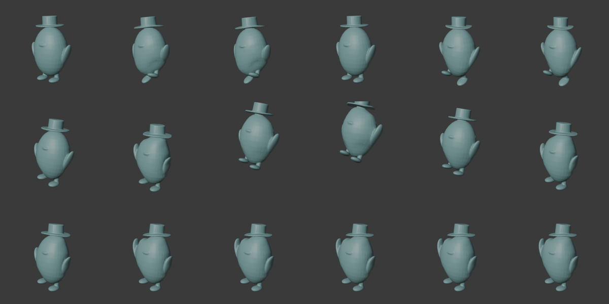

# Blender AI Studio

Une application de bureau Linux pour fabriquer un personnage 3D animé sans connaître Blender :
une image ou une description → un modèle 3D → nettoyé → squeletté → animé → exporté.
Une IA (Claude ou un modèle local) pilote Blender pour tout le reste, en langage naturel.



## Ce que ça fait

| Étape | Comment |
|---|---|
| **1. Créer** | Image ou texte → modèle 3D avec TRELLIS (Microsoft, MIT) ou Hunyuan3D-2, sur ta carte graphique. Ou import d'un `.glb/.gltf/.obj/.fbx/.stl/.ply`. |
| **2. Alléger** | Fusion des sommets en double, faces cassées, normales, réduction au nombre de faces voulu, pieds au sol, hauteur 1 m. |
| **3. Squelette** | Auto-rig : hanches, colonne, tête, bras et jambes placés d'après la forme, puis poids automatiques (repli par proximité si le maillage IA n'est pas étanche). |
| **4. Animer** | Respiration, marche dandinée, saut, coucou : animations procédurales en boucle, rangées en pistes NLA. |
| **5. Exporter** | GLB (web, Godot, three.js) avec une page web prête à publier, FBX (Unity, Unreal : une « take » par animation), OBJ. |
| **Assistant** | « Ajoute un chapeau de cowboy », « fais-lui une danse » : l'IA lit la scène et exécute du Python dans Blender, avec ta validation. |

L'aperçu 3D (three.js) se met à jour après chaque étape et lit toutes les animations.

## Confort d'utilisation

- **Tout d'un coup** : case « Enchaîner squelette, animations et export » (cochée par défaut).
  Une image ou un fichier 3D, un clic, et le personnage ressort animé et exporté.
- **Annuler** à tout moment : bouton dans la barre du haut ou `Échap`, avec le temps écoulé.
- **Check-list de démarrage** au premier lancement (Blender, IA, génération 3D), et boutons
  **Tester** dans les réglages, qui essaient les valeurs avant même de les enregistrer.
- **Vue 3D** : recadrer, squelette, fil de fer, rotation automatique, capture PNG,
  vitesse de lecture ×0,5 / ×1 / ×2. Tes choix sont retenus.
- **Projets** : créer, rouvrir, renommer, mettre à la corbeille (récupérable). Le projet prend
  le nom du fichier importé, et l'app rouvre la première étape qui reste à faire.
- **Assistant** : la conversation est gardée par projet (et relue après un redémarrage),
  réponses mises en forme, bouton pour copier le code.
- **Notifications** avec raccourci vers la bonne action (réglages, dossier, Blender).
- **Raccourcis clavier** : bouton clavier en haut à droite ou `?`.

| Touche | Action | Touche | Action |
|---|---|---|---|
| `Ctrl+N` | Projets | `Espace` | Lecture / pause |
| `Ctrl+O` | Importer un fichier 3D | `F` | Recadrer |
| `Ctrl+Entrée` | Générer depuis la description | `K` | Squelette |
| `Alt+1…5` | Ouvrir une étape | `W` | Fil de fer |
| `Échap` | Annuler la tâche | `R` | Rotation automatique |
| `/` | Écrire à l'assistant | `P` | Capture PNG |



## Installation (Fedora, et la plupart des Linux)

```bash
git clone https://github.com/MamaLama0/blender-ai-studio.git
cd blender-ai-studio
./install.sh
```

Le script vérifie Python ≥ 3.10, propose d'installer Blender (`dnf`, `apt`, `pacman` ou Flatpak),
crée un environnement isolé dans `~/.local/share/blender-ai-studio`, et ajoute l'appli au menu.
Lancer : **Blender AI Studio** dans le menu, ou `blender-ai-studio` dans un terminal.

Désinstaller : `./uninstall.sh` (tes projets et réglages sont conservés).

## Premier lancement

1. **Réglages** (roue en haut à droite) → choisis l'IA :
   - **Claude** : colle ta clé API Anthropic (rangée dans le trousseau GNOME/KDE, pas en clair).
   - **Ollama** : `ollama pull qwen3:14b` puis `ollama serve`. Le modèle doit savoir appeler des outils.
2. **Génération 3D** : le bandeau t'indique ce que ta carte graphique permet (voir plus bas).
3. Clique **Ouvrir dans Blender** pour que l'assistant puisse travailler. Sans Blender ouvert,
   les étapes 1 à 5 tournent quand même dans un Blender invisible en arrière-plan.

## Génération 3D : quel moteur ?

| Moteur | Licence | Matériel | Remarque |
|---|---|---|---|
| **TRELLIS** (défaut) | MIT | NVIDIA ≥ 16 Go | Image ou texte. |
| **Hunyuan3D-2** | Tencent Hunyuan | NVIDIA 6 Go (mini) à 12-16 Go (avec texture) | ⚠ **La licence exclut l'Union européenne, le Royaume-Uni et la Corée du Sud.** |
| **Ta commande** | — | — | N'importe quel script qui accepte `{image}`, `{text}`, `{output}`. |
| **Aucun** | — | — | Tu importes des modèles faits ailleurs. |

Sans carte NVIDIA (AMD, Intel, portable), utilise « Aucun » ou un serveur distant :
le nettoyage, le rig, l'animation et l'export marchent sur n'importe quelle machine.

**Installer TRELLIS** (environnement conda séparé, à faire une fois) :

```bash
git clone --recurse-submodules https://github.com/microsoft/TRELLIS ~/TRELLIS
cd ~/TRELLIS
. ./setup.sh --new-env --basic --xformers --flash-attn --diffoctreerast --spconv --mipgaussian --kaolin --nvdiffrast
```

Puis dans Réglages : dossier `~/TRELLIS`, Python `~/miniconda3/envs/trellis/bin/python`.
L'appli appelle `blender_ai_studio/servers/trellis_generate.py` avec ce Python.

**Hunyuan3D-2** (hors UE) : dans le dépôt Tencent, `python api_server.py --port 8080 --enable_tex`,
puis choisis « Hunyuan3D-2 » dans Réglages.

## Les garde-fous de l'assistant

L'idée vient d'un article sur un « routeur » qui décide, avant chaque action d'un agent, s'il faut
continuer, arrêter de réessayer ou demander à un humain. Ici c'est appliqué dans le code, pas
seulement suggéré au modèle :

- **Validation** : chaque bout de code Python est montré avant de tourner dans Blender (désactivable).
- **Stop aux boucles** : la même erreur deux fois → l'IA s'arrête et te demande comment continuer.
- **Budget** : 12 actions maximum par demande (réglable).
- **Journal** : chaque décision est écrite dans `decisions.jsonl` dans le dossier du projet.
- **Bouton Arrêter** pendant que l'IA travaille.

## Utiliser le pont avec Claude Desktop ou Claude Code

Le pont Blender de l'appli (`blender_side/bas_bridge.py`, port 9876, local uniquement) parle le même
protocole que l'add-on [blender-mcp](https://github.com/ahujasid/blender-mcp) pour les commandes
de base (scène, objets, code, capture). Tu peux donc aussi brancher le serveur MCP officiel :

```json
{ "mcpServers": { "blender": { "command": "uvx", "args": ["blender-mcp"] } } }
```

Pour l'installer comme add-on Blender classique : *Édition → Préférences → Add-ons →
Installer depuis le disque* → `bas_bridge.py`, puis panneau **AI Studio** (touche N).

## Où sont les fichiers

```
~/BlenderAIStudio/<nom du perso>/
  projet.blend        le fichier Blender
  apercu.glb          ce qu'affiche l'aperçu
  sources/            images et modèles d'origine
  exports/            .glb/.fbx/.obj + index.html (page web three.js)
  captures/           images enregistrées depuis la vue 3D
  chat.jsonl          conversation affichée
  conversation-*.json mémoire de l'assistant (Claude ou Ollama)
  decisions.jsonl     journal des décisions de l'assistant
~/.config/blender-ai-studio/config.json   réglages
~/.config/blender-ai-studio/interface.json  préférences d'affichage
```

## Comment l'auto-rig trouve les os

Le maillage est coupé en tranches horizontales (intersection des triangles avec un plan) :

- **jambes** : en montant depuis le sol, tant que le centre est *dehors* (entre les jambes) ;
  les hanches sont juste au-dessus de l'entrejambe ;
- **cou** : un rétrécissement suivi d'une partie plus large (la tête) ; sinon 70 % de la hauteur ;
- **bras** : les points les plus écartés entre hanches et épaules, s'ils dépassent nettement du tronc.

Les tranches marchent même sur un maillage décimé (grandes faces sans sommet au milieu).
Contrôle visuel sur trois cas (marche, saut, coucou) avec `tests/visual_check.py` :




## Limites connues

- **L'auto-rig vise les personnages « toon » et bipèdes** (proportions simples, bras écartés).
  Pour un humain réaliste avec des doigts, passe plutôt par Mixamo ou UniRig, puis importe le FBX
  rigué : les étapes 4 et 5 et l'assistant fonctionnent dessus.
- Les animations sont procédurales : parfaites pour un prototype, un jeu indé ou un réseau social,
  moins pour un film. L'assistant peut les retoucher ou en créer d'autres.
- La génération 3D locale demande une carte NVIDIA (CUDA).

## Architecture

```
blender_ai_studio/
  app.py            fenêtre Qt + serveur HTTP local (127.0.0.1, jeton secret)
  backend.py        pont Python ↔ page web (QWebChannel)
  pipeline.py       lance les étapes dans Blender ouvert (pont) ou en arrière-plan
  agent.py          boucle de l'IA (Claude API / Ollama) + garde-fous
  generators.py     TRELLIS, Hunyuan3D, commande perso
  hardware.py       détection de la carte graphique
  blender_side/     code qui tourne DANS Blender (pont, étapes du pipeline)
  ui/               interface (HTML/CSS/JS, three.js et polices embarqués, marche hors ligne)
```

L'interface est une page web dans une fenêtre native : on peut y intégrer des composants
React (Cue, shadcn…) plus tard sans toucher au moteur Python.

## Tests

```bash
pip install bpy PySide6           # bpy = Blender en module Python
python tests/test_pipeline_bpy.py # import → rig → 4 animations → export GLB vérifié
python tests/test_bridge_agent.py # pont, pipeline en direct, agent Claude/Ollama et garde-fous (IA simulée)
QT_QPA_PLATFORM=offscreen python tests/test_backend.py   # annulation, enchaînement, Tester, projets, historique
python tests/visual_check.py /tmp/rendus penguin humanoid blob   # planches de rendu du rig
```

`tests/fake_blender.py` imite la ligne de commande de Blender avec `bpy` pour tester l'appli
complète sans Blender installé, et `tests/screenshot.py` pilote l'interface hors écran
(scénario JS ou Python) pour en faire des captures.

## Dépannage

- **Aperçu 3D noir** : `BAS_SOFTWARE_GL=1 blender-ai-studio` (rendu logiciel).
- **« Blender introuvable »** : Réglages → Programme Blender (`/usr/bin/blender`, ou
  `/var/lib/flatpak/exports/bin/org.blender.Blender` pour Flatpak).
- **Port 9876 occupé** (add-on blender-mcp déjà actif) : change le port dans Réglages.
- **Pas de détection du GPU NVIDIA sur Fedora** : installe le pilote propriétaire via RPM Fusion
  (`akmod-nvidia`) ; `nvidia-smi` doit répondre.
- **Sécurité** : le pont n'écoute que sur 127.0.0.1, mais tout programme local peut lui envoyer
  du code (comme l'add-on blender-mcp). Ferme Blender quand tu ne t'en sers pas.

Polices : Inter et Bricolage Grotesque (SIL OFL). three.js (MIT). Licences dans `ui/vendor/`.
